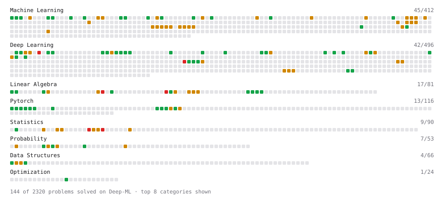

# Deep-ML

My machine learning practice from [Deep-ML](https://www.deep-ml.com). Every solution here was written by hand.

**219** solved · 156 problems · 5 labs · 58 math

[**Browse the interactive portfolio**](https://PabloVM.github.io/deep-ml/) to replay this filling in over time.

## Problems

| | Difficulty | Solved | |
| --- | --- | --- | --- |
| [Activation Health Check: Saturated and Dead tanh Units](https://www.deep-ml.com/problems/1996) | easy | 2026-11-16 | [solution](problems/1996-activation-health-check-saturated-and-dead-tanh-units) |
| [Add a Bias Vector to a Batch via Broadcasting](https://www.deep-ml.com/problems/882) | easy | 2026-11-17 | [solution](problems/0882-add-a-bias-vector-to-a-batch-via-broadcasting) |
| [Backprop a Linear Layer by Hand](https://www.deep-ml.com/problems/898) | easy | 2026-11-17 | [solution](problems/0898-backprop-a-linear-layer-by-hand) |
| [Backward Pass of Tanh Using Cached Output](https://www.deep-ml.com/problems/999) | easy | 2026-11-06 | [solution](problems/0999-backward-pass-of-tanh-using-cached-output) |
| [Backward Pass of Tensor Reshape](https://www.deep-ml.com/problems/1000) | easy | 2026-11-09 | [solution](problems/1000-backward-pass-of-tensor-reshape) |
| [Batch a TensorDataset with DataLoader](https://www.deep-ml.com/problems/1237) | easy | 2026-11-17 | [solution](problems/1237-batch-a-tensordataset-with-dataloader) |
| [Batch Iterator for Dataset](https://www.deep-ml.com/problems/30) | easy | 2026-10-22 | [solution](problems/0030-batch-iterator-for-dataset) |
| [Build a Dataset and Use It with a DataLoader](https://www.deep-ml.com/problems/899) | easy | 2026-11-17 | [solution](problems/0899-build-a-dataset-and-use-it-with-a-dataloader) |
| [Build a Linear Regression Model with nn.Module](https://www.deep-ml.com/problems/885) | easy | 2026-11-17 | [solution](problems/0885-build-a-linear-regression-model-with-nn-module) |
| [Build an MLP with nn.Sequential](https://www.deep-ml.com/problems/887) | easy | 2026-11-17 | [solution](problems/0887-build-an-mlp-with-nn-sequential) |
| [Calculate 2x2 Matrix Inverse](https://www.deep-ml.com/problems/8) | easy | 2026-10-20 | [solution](problems/0008-calculate-2x2-matrix-inverse) |
| [Calculate Mean Absolute Error (MAE)](https://www.deep-ml.com/problems/93) | easy | 2026-10-27 | [solution](problems/0093-calculate-mean-absolute-error-mae) |
| [Calculate Number of Parameters in Neural Network](https://www.deep-ml.com/problems/371) | easy | 2026-11-16 | [solution](problems/0371-calculate-number-of-parameters-in-neural-network) |
| [Calculate R-squared for Regression Analysis](https://www.deep-ml.com/problems/69) | easy | 2026-10-27 | [solution](problems/0069-calculate-r-squared-for-regression-analysis) |
| [Calculate Root Mean Square Error (RMSE)](https://www.deep-ml.com/problems/71) | easy | 2026-10-27 | [solution](problems/0071-calculate-root-mean-square-error-rmse) |
| [Compute a Gradient with PyTorch Autograd](https://www.deep-ml.com/problems/884) | easy | 2026-11-17 | [solution](problems/0884-compute-a-gradient-with-pytorch-autograd) |
| [Compute Posterior Probability using Bayes' Theorem](https://www.deep-ml.com/problems/336) | easy | 2026-11-03 | [solution](problems/0336-compute-posterior-probability-using-bayes-theorem) |
| [Count Parameters of a Sequential Model](https://www.deep-ml.com/problems/1218) | easy | 2026-11-17 | [solution](problems/1218-count-parameters-of-a-sequential-model) |
| [Create a Float Tensor from a Python List](https://www.deep-ml.com/problems/880) | easy | 2026-11-17 | [solution](problems/0880-create-a-float-tensor-from-a-python-list) |
| [Create a Float Tensor with Tinygrad](https://www.deep-ml.com/problems/889) | easy | 2026-11-18 | [solution](problems/0889-create-a-float-tensor-with-tinygrad) |
| [Create and Inspect a Tensor](https://www.deep-ml.com/problems/1220) | easy | 2026-11-17 | [solution](problems/1220-create-and-inspect-a-tensor) |
| [Derivative of a Polynomial](https://www.deep-ml.com/problems/116) | easy | 2026-10-20 | [solution](problems/0116-derivative-of-a-polynomial) |
| [Derivatives of Activation Functions](https://www.deep-ml.com/problems/217) | easy | 2026-11-04 | [solution](problems/0217-derivatives-of-activation-functions) |
| [Descriptive Statistics Calculator](https://www.deep-ml.com/problems/78) | easy | 2026-10-22 | [solution](problems/0078-descriptive-statistics-calculator) |
| [Detect Overfitting or Underfitting](https://www.deep-ml.com/problems/86) | easy | 2026-10-27 | [solution](problems/0086-detect-overfitting-or-underfitting) |
| [Dynamic Tanh: Normalization-Free Transformer Activation](https://www.deep-ml.com/problems/128) | easy | 2026-11-03 | [solution](problems/0128-dynamic-tanh-normalization-free-transformer-activation) |
| [Early Stopping Based on Validation Loss Plateau](https://www.deep-ml.com/problems/199) | easy | 2026-10-29 | [solution](problems/0199-early-stopping-based-on-validation-loss-plateau) |
| [Expected Value and Variance of an n-Sided Die](https://www.deep-ml.com/problems/179) | easy | 2026-10-29 | [solution](problems/0179-expected-value-and-variance-of-an-n-sided-die) |
| [Feature Scaling Implementation](https://www.deep-ml.com/problems/16) | easy | 2026-10-27 | [solution](problems/0016-feature-scaling-implementation) |
| [GeLU Activation Function ](https://www.deep-ml.com/problems/147) | easy | 2026-11-03 | [solution](problems/0147-gelu-activation-function) |
| [Gradient Direction and Magnitude](https://www.deep-ml.com/problems/308) | easy | 2026-10-20 | [solution](problems/0308-gradient-direction-and-magnitude) |
| [Gradient of a Square with Autograd](https://www.deep-ml.com/problems/1222) | easy | 2026-11-17 | [solution](problems/1222-gradient-of-a-square-with-autograd) |
| [Implement a Linear Layer Forward Pass with Matrix Multiplication](https://www.deep-ml.com/problems/883) | easy | 2026-11-17 | [solution](problems/0883-implement-a-linear-layer-forward-pass-with-matrix-multiplication) |
| [Implement Early Stopping Based on Validation Loss](https://www.deep-ml.com/problems/135) | easy | 2026-10-29 | [solution](problems/0135-implement-early-stopping-based-on-validation-loss) |
| [Implement He Weight Initialization](https://www.deep-ml.com/problems/290) | easy | 2026-11-15 | [solution](problems/0290-implement-he-weight-initialization) |
| [Implement Orthogonal Projection of a Vector onto a Line](https://www.deep-ml.com/problems/66) | easy | 2026-10-20 | [solution](problems/0066-implement-orthogonal-projection-of-a-vector-onto-a-line) |
| [Implement ReLU Activation Function](https://www.deep-ml.com/problems/42) | easy | 2026-11-03 | [solution](problems/0042-implement-relu-activation-function) |
| [Implement Ridge Regression Loss Function](https://www.deep-ml.com/problems/43) | easy | 2026-10-28 | [solution](problems/0043-implement-ridge-regression-loss-function) |
| [Implement SwiGLU activation function](https://www.deep-ml.com/problems/156) | easy | 2026-11-03 | [solution](problems/0156-implement-swiglu-activation-function) |
| [Implement the ELU Activation Function](https://www.deep-ml.com/problems/97) | easy | 2026-11-03 | [solution](problems/0097-implement-the-elu-activation-function) |
| [Implement the Hard Sigmoid Activation Function](https://www.deep-ml.com/problems/96) | easy | 2026-11-03 | [solution](problems/0096-implement-the-hard-sigmoid-activation-function) |
| [Implement the Hardtanh Activation Function](https://www.deep-ml.com/problems/266) | easy | 2026-11-03 | [solution](problems/0266-implement-the-hardtanh-activation-function) |
| [Implement the Mish Activation Function](https://www.deep-ml.com/problems/262) | easy | 2026-11-03 | [solution](problems/0262-implement-the-mish-activation-function) |
| [Implement the SELU Activation Function](https://www.deep-ml.com/problems/103) | easy | 2026-11-03 | [solution](problems/0103-implement-the-selu-activation-function) |
| [Implement the Softplus Activation Function](https://www.deep-ml.com/problems/99) | easy | 2026-11-03 | [solution](problems/0099-implement-the-softplus-activation-function) |
| [Implement the Softsign Activation Function](https://www.deep-ml.com/problems/100) | easy | 2026-11-03 | [solution](problems/0100-implement-the-softsign-activation-function) |
| [Implement the Square ReLU Activation Function](https://www.deep-ml.com/problems/373) | easy | 2026-11-03 | [solution](problems/0373-implement-the-square-relu-activation-function) |
| [Implement the Swish Activation Function](https://www.deep-ml.com/problems/102) | easy | 2026-11-03 | [solution](problems/0102-implement-the-swish-activation-function) |
| [Implement the Tanh Activation Function](https://www.deep-ml.com/problems/264) | easy | 2026-11-03 | [solution](problems/0264-implement-the-tanh-activation-function) |
| [Implement Weight Decay as L2 Regularization](https://www.deep-ml.com/problems/198) | easy | 2026-10-29 | [solution](problems/0198-implement-weight-decay-as-l2-regularization) |
| [Implement Xavier/Glorot Weight Initialization](https://www.deep-ml.com/problems/369) | easy | 2026-11-15 | [solution](problems/0369-implement-xavier-glorot-weight-initialization) |
| [Label Encoding for Ordinal Variables](https://www.deep-ml.com/problems/356) | easy | 2026-10-27 | [solution](problems/0356-label-encoding-for-ordinal-variables) |
| [Leaky ReLU Activation Function](https://www.deep-ml.com/problems/44) | easy | 2026-11-03 | [solution](problems/0044-leaky-relu-activation-function) |
| [Learning Rate Range Finder for Linear Regression](https://www.deep-ml.com/problems/990) | easy | 2026-10-21 | [solution](problems/0990-learning-rate-range-finder-for-linear-regression) |
| [Linear Regression Using Gradient Descent](https://www.deep-ml.com/problems/15) | easy | 2026-10-20 | [solution](problems/0015-linear-regression-using-gradient-descent) |
| [Linear Regression Using Normal Equation](https://www.deep-ml.com/problems/14) | easy | 2026-10-20 | [solution](problems/0014-linear-regression-using-normal-equation) |
| [Matrix-Vector Dot Product](https://www.deep-ml.com/problems/1) | easy | 2026-10-20 | [solution](problems/0001-matrix-vector-dot-product) |
| [Min-Max Scaling of Feature Values](https://www.deep-ml.com/problems/112) | easy | 2026-10-25 | [solution](problems/0112-min-max-scaling-of-feature-values) |
| [One-Hot Encoding of Nominal Values](https://www.deep-ml.com/problems/34) | easy | 2026-10-25 | [solution](problems/0034-one-hot-encoding-of-nominal-values) |
| [Random Shuffle of Dataset](https://www.deep-ml.com/problems/29) | easy | 2026-10-22 | [solution](problems/0029-random-shuffle-of-dataset) |
| [Random Train/Validation/Test Split with Shuffling](https://www.deep-ml.com/problems/1058) | easy | 2026-10-22 | [solution](problems/1058-random-train-validation-test-split-with-shuffling) |
| [Reduce Gradient Across Broadcasted Dimensions](https://www.deep-ml.com/problems/998) | easy | 2026-11-06 | [solution](problems/0998-reduce-gradient-across-broadcasted-dimensions) |
| [Reshape and Transpose a Tensor](https://www.deep-ml.com/problems/1221) | easy | 2026-11-17 | [solution](problems/1221-reshape-and-transpose-a-tensor) |
| [Reshape and Transpose a Tensor](https://www.deep-ml.com/problems/881) | easy | 2026-11-17 | [solution](problems/0881-reshape-and-transpose-a-tensor) |
| [Run One Training Step: Forward, Loss, Backward, Optimizer](https://www.deep-ml.com/problems/886) | easy | 2026-11-17 | [solution](problems/0886-run-one-training-step-forward-loss-backward-optimizer) |
| [Sampling Distribution of the Mean](https://www.deep-ml.com/problems/181) | easy | 2026-10-30 | [solution](problems/0181-sampling-distribution-of-the-mean) |
| [Save and Load Model Weights with state_dict](https://www.deep-ml.com/problems/888) | easy | 2026-11-17 | [solution](problems/0888-save-and-load-model-weights-with-state-dict) |
| [Shift and Scale Array to Target Range](https://www.deep-ml.com/problems/141) | easy | 2026-10-25 | [solution](problems/0141-shift-and-scale-array-to-target-range) |
| [Single Linear Neuron Forward](https://www.deep-ml.com/problems/1224) | easy | 2026-11-17 | [solution](problems/1224-single-linear-neuron-forward) |
| [Single Neuron](https://www.deep-ml.com/problems/24) | easy | 2026-11-03 | [solution](problems/0024-single-neuron) |
| [Smooth L1 Loss with a Beta Parameter](https://www.deep-ml.com/problems/1372) | easy | 2026-10-27 | [solution](problems/1372-smooth-l1-loss-with-a-beta-parameter) |
| [Softmax Activation Function Implementation ](https://www.deep-ml.com/problems/23) | easy | 2026-11-02 | [solution](problems/0023-softmax-activation-function-implementation) |
| [Tensor Puzzle: Extract the Diagonal](https://www.deep-ml.com/problems/1271) | easy | 2026-11-02 | [solution](problems/1271-tensor-puzzle-extract-the-diagonal) |
| [Tensor Puzzle: Ones Vector from First Principles](https://www.deep-ml.com/problems/1268) | easy | 2026-11-02 | [solution](problems/1268-tensor-puzzle-ones-vector-from-first-principles) |
| [Tensor Puzzle: Outer Product via Broadcasting](https://www.deep-ml.com/problems/1270) | easy | 2026-11-02 | [solution](problems/1270-tensor-puzzle-outer-product-via-broadcasting) |
| [Tensor Puzzle: Sum a Vector with a Dot Product](https://www.deep-ml.com/problems/1269) | easy | 2026-11-02 | [solution](problems/1269-tensor-puzzle-sum-a-vector-with-a-dot-product) |
| [Thanksgiving Feast Predictor: Softmax for Dish Selection](https://www.deep-ml.com/problems/216) | easy | 2026-11-04 | [solution](problems/0216-thanksgiving-feast-predictor-softmax-for-dish-selection) |
| [Transpose of a Matrix](https://www.deep-ml.com/problems/2) | easy | 2026-10-20 | [solution](problems/0002-transpose-of-a-matrix) |
| [Update-to-Data Ratio: Which Layers Train Too Fast?](https://www.deep-ml.com/problems/1997) | easy | 2026-11-16 | [solution](problems/1997-update-to-data-ratio-which-layers-train-too-fast) |
| [Vector Norms (L1/L2/L-inf) and the Frobenius Norm](https://www.deep-ml.com/problems/328) | easy | 2026-10-27 | [solution](problems/0328-vector-norms-l1-l2-l-inf-and-the-frobenius-norm) |
| [Backpropagation Gradients for a Dense Layer](https://www.deep-ml.com/problems/1076) | medium | 2026-11-06 | [solution](problems/1076-backpropagation-gradients-for-a-dense-layer) |
| [Backpropagation Through a Scalar Chain Network](https://www.deep-ml.com/problems/1075) | medium | 2026-11-05 | [solution](problems/1075-backpropagation-through-a-scalar-chain-network) |
| [Backward Pass of Row-wise Max Operation](https://www.deep-ml.com/problems/1001) | medium | 2026-11-09 | [solution](problems/1001-backward-pass-of-row-wise-max-operation) |
| [Bayesian Inference for Beta-Binomial Model](https://www.deep-ml.com/problems/213) | medium | 2026-11-03 | [solution](problems/0213-bayesian-inference-for-beta-binomial-model) |
| [Beta Distribution PDF and Statistics](https://www.deep-ml.com/problems/339) | medium | 2026-11-03 | [solution](problems/0339-beta-distribution-pdf-and-statistics) |
| [Bias-Variance Decomposition from Bootstrap](https://www.deep-ml.com/problems/804) | medium | 2026-10-29 | [solution](problems/0804-bias-variance-decomposition-from-bootstrap) |
| [Calculate BIC/AIC for Model Selection](https://www.deep-ml.com/problems/368) | medium | 2026-10-29 | [solution](problems/0368-calculate-bic-aic-for-model-selection) |
| [Calculate Number of Parameters in Neural Network](https://www.deep-ml.com/problems/291) | medium | 2026-11-16 | [solution](problems/0291-calculate-number-of-parameters-in-neural-network) |
| [Central Limit Theorem Simulation](https://www.deep-ml.com/problems/182) | medium | 2026-10-30 | [solution](problems/0182-central-limit-theorem-simulation) |
| [Chain Rule for Composite Functions](https://www.deep-ml.com/problems/214) | medium | 2026-10-20 | [solution](problems/0214-chain-rule-for-composite-functions) |
| [Check if Matrix is Positive Definite](https://www.deep-ml.com/problems/332) | medium | 2026-10-28 | [solution](problems/0332-check-if-matrix-is-positive-definite) |
| [Cholesky Decomposition](https://www.deep-ml.com/problems/334) | medium | 2026-10-21 | [solution](problems/0334-cholesky-decomposition) |
| [Classify Critical Points Using Hessian Eigenvalues](https://www.deep-ml.com/problems/311) | medium | 2026-10-28 | [solution](problems/0311-classify-critical-points-using-hessian-eigenvalues) |
| [ColumnTransformer-Style Dispatcher](https://www.deep-ml.com/problems/845) | medium | 2026-10-26 | [solution](problems/0845-columntransformer-style-dispatcher) |
| [Compute the Hessian Matrix](https://www.deep-ml.com/problems/218) | medium | 2026-10-28 | [solution](problems/0218-compute-the-hessian-matrix) |
| [Conditional Probability from Joint Distribution](https://www.deep-ml.com/problems/180) | medium | 2026-11-03 | [solution](problems/0180-conditional-probability-from-joint-distribution) |
| [Confidence Intervals versus Prediction Intervals](https://www.deep-ml.com/problems/1362) | medium | 2026-11-02 | [solution](problems/1362-confidence-intervals-versus-prediction-intervals) |
| [Cross-Validated Lambda and the One-Standard-Error Rule](https://www.deep-ml.com/problems/1417) | medium | 2026-10-29 | [solution](problems/1417-cross-validated-lambda-and-the-one-standard-error-rule) |
| [Cross-Validated Prediction with K-Fold Linear Regression](https://www.deep-ml.com/problems/839) | medium | 2026-10-27 | [solution](problems/0839-cross-validated-prediction-with-k-fold-linear-regression) |
| [Custom Autograd Function: Swish Forward and Backward](https://www.deep-ml.com/problems/1399) | medium | 2026-11-17 | [solution](problems/1399-custom-autograd-function-swish-forward-and-backward) |
| [Detect Look-Ahead Bias in a Feature Pipeline](https://www.deep-ml.com/problems/1352) | medium | 2026-10-27 | [solution](problems/1352-detect-look-ahead-bias-in-a-feature-pipeline) |
| [Detect Target Leakage in a Feature Matrix](https://www.deep-ml.com/problems/1359) | medium | 2026-10-27 | [solution](problems/1359-detect-target-leakage-in-a-feature-matrix) |
| [Dummy Classifier Baseline](https://www.deep-ml.com/problems/847) | medium | 2026-10-26 | [solution](problems/0847-dummy-classifier-baseline) |
| [Dummy Regressor Baseline](https://www.deep-ml.com/problems/848) | medium | 2026-10-26 | [solution](problems/0848-dummy-regressor-baseline) |
| [Elastic Net Regression via Gradient Descent](https://www.deep-ml.com/problems/139) | medium | 2026-10-29 | [solution](problems/0139-elastic-net-regression-via-gradient-descent) |
| [Feature Hashing Trick for Sparse Features](https://www.deep-ml.com/problems/846) | medium | 2026-10-26 | [solution](problems/0846-feature-hashing-trick-for-sparse-features) |
| [Forward Stepwise Selection Scored by Cp, AIC and BIC](https://www.deep-ml.com/problems/1415) | medium | 2026-10-29 | [solution](problems/1415-forward-stepwise-selection-scored-by-cp-aic-and-bic) |
| [Gaussian Elimination for Solving Linear Systems](https://www.deep-ml.com/problems/58) | medium | 2026-10-21 | [solution](problems/0058-gaussian-elimination-for-solving-linear-systems) |
| [Gradient of a Weighted Sum of Squares](https://www.deep-ml.com/problems/1223) | medium | 2026-11-17 | [solution](problems/1223-gradient-of-a-weighted-sum-of-squares) |
| [Handle Missing Data with Imputation](https://www.deep-ml.com/problems/354) | medium | 2026-10-26 | [solution](problems/0354-handle-missing-data-with-imputation) |
| [Implement a Custom `autograd.Function`](https://www.deep-ml.com/problems/903) | medium | 2026-11-17 | [solution](problems/0903-implement-a-custom-autograd-function) |
| [Implement Gradient Descent Variants with MSE Loss](https://www.deep-ml.com/problems/47) | medium | 2026-10-20 | [solution](problems/0047-implement-gradient-descent-variants-with-mse-loss) |
| [Implement Grid Search](https://www.deep-ml.com/problems/288) | medium | 2026-10-29 | [solution](problems/0288-implement-grid-search) |
| [Implement He Weight Initialization for Neural Networks](https://www.deep-ml.com/problems/370) | medium | 2026-11-16 | [solution](problems/0370-implement-he-weight-initialization-for-neural-networks) |
| [Implement K-Fold Cross-Validation](https://www.deep-ml.com/problems/18) | medium | 2026-10-22 | [solution](problems/0018-implement-k-fold-cross-validation) |
| [Implement Lasso Regression using ISTA](https://www.deep-ml.com/problems/50) | medium | 2026-10-29 | [solution](problems/0050-implement-lasso-regression-using-ista) |
| [Implement PReLU Forward and Backward Pass](https://www.deep-ml.com/problems/98) | medium | 2026-11-04 | [solution](problems/0098-implement-prelu-forward-and-backward-pass) |
| [Implement Stratified K-Fold Cross-Validation](https://www.deep-ml.com/problems/840) | medium | 2026-10-25 | [solution](problems/0840-implement-stratified-k-fold-cross-validation) |
| [Implement Stratified Train-Test Split](https://www.deep-ml.com/problems/275) | medium | 2026-10-23 | [solution](problems/0275-implement-stratified-train-test-split) |
| [Implement the Huber Loss Function](https://www.deep-ml.com/problems/192) | medium | 2026-10-27 | [solution](problems/0192-implement-the-huber-loss-function) |
| [Implement Xavier/Glorot Weight Initialization](https://www.deep-ml.com/problems/289) | medium | 2026-11-15 | [solution](problems/0289-implement-xavier-glorot-weight-initialization) |
| [Implementing Basic Autograd Operations](https://www.deep-ml.com/problems/26) | medium | 2026-11-05 | [solution](problems/0026-implementing-basic-autograd-operations) |
| [Jacobian Matrix Calculation](https://www.deep-ml.com/problems/202) | medium | 2026-11-05 | [solution](problems/0202-jacobian-matrix-calculation) |
| [Jacobians by Forward Mode and by Reverse Mode](https://www.deep-ml.com/problems/1835) | medium | 2026-11-05 | [solution](problems/1835-jacobians-by-forward-mode-and-by-reverse-mode) |
| [Lagrange Multipliers for Constrained Quadratic Optimization](https://www.deep-ml.com/problems/314) | medium | 2026-10-28 | [solution](problems/0314-lagrange-multipliers-for-constrained-quadratic-optimization) |
| [Learning Curve Generator for Bias-Variance Diagnosis](https://www.deep-ml.com/problems/800) | medium | 2026-10-27 | [solution](problems/0800-learning-curve-generator-for-bias-variance-diagnosis) |
| [Linear Regression - Power Grid Optimization](https://www.deep-ml.com/problems/92) | medium | 2026-10-20 | [solution](problems/0092-linear-regression-power-grid-optimization) |
| [LSUV: Orthonormal Init plus Layer-Sequential Unit Variance](https://www.deep-ml.com/problems/1837) | medium | 2026-11-16 | [solution](problems/1837-lsuv-orthonormal-init-plus-layer-sequential-unit-variance) |
| [LU Decomposition of a Square Matrix](https://www.deep-ml.com/problems/333) | medium | 2026-10-21 | [solution](problems/0333-lu-decomposition-of-a-square-matrix) |
| [Matrix Rank](https://www.deep-ml.com/problems/329) | medium | 2026-11-02 | [solution](problems/0329-matrix-rank) |
| [Matrix times Matrix ](https://www.deep-ml.com/problems/9) | medium | 2026-10-20 | [solution](problems/0009-matrix-times-matrix) |
| [Maximum A Posteriori (MAP) Estimation for Bernoulli Parameter](https://www.deep-ml.com/problems/338) | medium | 2026-10-29 | [solution](problems/0338-maximum-a-posteriori-map-estimation-for-bernoulli-parameter) |
| [Maximum Likelihood Estimation for Gaussian Distribution](https://www.deep-ml.com/problems/337) | medium | 2026-10-30 | [solution](problems/0337-maximum-likelihood-estimation-for-gaussian-distribution) |
| [Mini-Batch Gradient Descent Step for Linear Regression](https://www.deep-ml.com/problems/803) | medium | 2026-10-20 | [solution](problems/0803-mini-batch-gradient-descent-step-for-linear-regression) |
| [Monty Hall Posterior for n Doors and Two Host Models](https://www.deep-ml.com/problems/1718) | medium | 2026-11-03 | [solution](problems/1718-monty-hall-posterior-for-n-doors-and-two-host-models) |
| [Normal Distribution PDF Calculator](https://www.deep-ml.com/problems/80) | medium | 2026-10-30 | [solution](problems/0080-normal-distribution-pdf-calculator) |
| [Numerical Gradient Checking](https://www.deep-ml.com/problems/313) | medium | 2026-10-21 | [solution](problems/0313-numerical-gradient-checking) |
| [One Training Step](https://www.deep-ml.com/problems/1219) | medium | 2026-11-17 | [solution](problems/1219-one-training-step) |
| [Ordinal Encoding for Categorical Features](https://www.deep-ml.com/problems/843) | medium | 2026-10-26 | [solution](problems/0843-ordinal-encoding-for-categorical-features) |
| [Outlier Detection and Removal Using IQR Method](https://www.deep-ml.com/problems/355) | medium | 2026-10-26 | [solution](problems/0355-outlier-detection-and-removal-using-iqr-method) |
| [Partial Derivatives of Multivariable Functions](https://www.deep-ml.com/problems/215) | medium | 2026-10-20 | [solution](problems/0215-partial-derivatives-of-multivariable-functions) |
| [Randomized Search for Hyperparameter Tuning](https://www.deep-ml.com/problems/841) | medium | 2026-10-29 | [solution](problems/0841-randomized-search-for-hyperparameter-tuning) |
| [RBF Network: Design Matrix, Bandwidth, and XOR](https://www.deep-ml.com/problems/1836) | medium | 2026-11-04 | [solution](problems/1836-rbf-network-design-matrix-bandwidth-and-xor) |
| [RSE, R-Squared and the F-Statistic](https://www.deep-ml.com/problems/1361) | medium | 2026-11-02 | [solution](problems/1361-rse-r-squared-and-the-f-statistic) |
| [Single Neuron with Backpropagation](https://www.deep-ml.com/problems/25) | medium | 2026-11-05 | [solution](problems/0025-single-neuron-with-backpropagation) |
| [StandardScaler Fit and Transform](https://www.deep-ml.com/problems/842) | medium | 2026-10-25 | [solution](problems/0842-standardscaler-fit-and-transform) |
| [Steepest Descent with Exact and Armijo Line Search](https://www.deep-ml.com/problems/1780) | medium | 2026-11-18 | [solution](problems/1780-steepest-descent-with-exact-and-armijo-line-search) |
| [Stochastic Gradient Descent Step for Linear Regression](https://www.deep-ml.com/problems/802) | medium | 2026-10-20 | [solution](problems/0802-stochastic-gradient-descent-step-for-linear-regression) |
| [Two-Layer MLP Forward Pass](https://www.deep-ml.com/problems/1225) | medium | 2026-11-17 | [solution](problems/1225-two-layer-mlp-forward-pass) |
| [Coefficient Standard Errors, t-Statistics and p-Values](https://www.deep-ml.com/problems/1360) | hard | 2026-11-02 | [solution](problems/1360-coefficient-standard-errors-t-statistics-and-p-values) |
| [Damped Newton and Trust-Region Steps](https://www.deep-ml.com/problems/1782) | hard | 2026-11-19 | [solution](problems/1782-damped-newton-and-trust-region-steps) |
| [Implement the Conjugate Gradient Method for Solving Linear Systems](https://www.deep-ml.com/problems/63) | hard | 2026-10-21 | [solution](problems/0063-implement-the-conjugate-gradient-method-for-solving-linear-systems) |
| [Implementing a Custom Dense Layer in Python](https://www.deep-ml.com/problems/40) | hard | 2026-11-05 | [solution](problems/0040-implementing-a-custom-dense-layer-in-python) |
| [Leverage, Studentized Residuals and Cook's Distance](https://www.deep-ml.com/problems/1363) | hard | 2026-11-02 | [solution](problems/1363-leverage-studentized-residuals-and-cook-s-distance) |
| [Manual Backprop Through Cross-Entropy Intermediates](https://www.deep-ml.com/problems/997) | hard | 2026-11-06 | [solution](problems/0997-manual-backprop-through-cross-entropy-intermediates) |
| [QR Decomposition](https://www.deep-ml.com/problems/201) | hard | 2026-10-21 | [solution](problems/0201-qr-decomposition) |

## Labs

| | Difficulty | Solved | |
| --- | --- | --- | --- |
| [Design Your Own Activation Function](https://www.deep-ml.com/labs/9) | easy | 2026-11-16 | [solution](labs/0009-design-your-own-activation-function) |
| [Split the Data Honestly and Beat a Baseline](https://www.deep-ml.com/labs/3d26c3f9-cb73-4ab1-bc4d-86cfab2af6d1) | easy | 2026-10-27 | [solution](labs/3d26c3f9-cb73-4ab1-bc4d-86cfab2af6d1-split-the-data-honestly-and-beat-a-baseline) |
| [Train a Linear Regression Model](https://www.deep-ml.com/labs/18) | easy | 2026-10-23 | [solution](labs/0018-train-a-linear-regression-model) |
| [Data Preprocessing: Handling Missing Values](https://www.deep-ml.com/labs/11) | medium | 2026-10-27 | [solution](labs/0011-data-preprocessing-handling-missing-values) |
| [MNIST: Build Neural Network from Scratch (NumPy Only)](https://www.deep-ml.com/labs/6) | hard | 2026-11-09 | [solution](labs/0006-mnist-build-neural-network-from-scratch-numpy-only) |

## Math

| | Difficulty | Solved | |
| --- | --- | --- | --- |
| [Derivatives and Gradients](https://www.deep-ml.com/math-problems/1) | easy | 2026-10-20 | [solution](math/0001-derivatives-and-gradients) |
| [Descriptive Statistics](https://www.deep-ml.com/math-problems/18) | easy | 2026-10-22 | [solution](math/0018-descriptive-statistics) |
| [Expectation and Variance Algebra](https://www.deep-ml.com/math-problems/33) | easy | 2026-10-29 | [solution](math/0033-expectation-and-variance-algebra) |
| [Gradient Descent Updates](https://www.deep-ml.com/math-problems/5) | easy | 2026-10-20 | [solution](math/0005-gradient-descent-updates) |
| [ML Workflow Basics](https://www.deep-ml.com/math-problems/30) | easy | 2026-10-22 | [solution](math/0030-ml-workflow-basics) |
| [Model Selection: CV, AIC, and BIC](https://www.deep-ml.com/math-problems/43) | easy | 2026-10-28 | [solution](math/0043-model-selection-cv-aic-and-bic) |
| [Probability Fundamentals](https://www.deep-ml.com/math-problems/19) | easy | 2026-10-29 | [solution](math/0019-probability-fundamentals) |
| [Standard Error and the Sampling Distribution of an Estimator](https://www.deep-ml.com/math-problems/73) | easy | 2026-10-30 | [solution](math/0073-standard-error-and-the-sampling-distribution-of-an-estimator) |
| [What the Bias Term Buys: Affine Maps, the Bias Gradient and When It Is Redundant](https://www.deep-ml.com/math-problems/277) | easy | 2026-11-03 | [solution](math/0277-what-the-bias-term-buys-affine-maps-the-bias-gradient-and-when-it-is-redundant) |
| [Why Constant Initialization Fails: Symmetric Hidden Units Get Identical Gradients](https://www.deep-ml.com/math-problems/622) | easy | 2026-11-15 | [solution](math/0622-why-constant-initialization-fails-symmetric-hidden-units-get-identical-gradients) |
| [Why Minibatches: Gradient Variance vs Batch Size](https://www.deep-ml.com/math-problems/130) | easy | 2026-10-20 | [solution](math/0130-why-minibatches-gradient-variance-vs-batch-size) |
| [XOR with Threshold Units, and Why Linear Layers Collapse](https://www.deep-ml.com/math-problems/469) | easy | 2026-11-03 | [solution](math/0469-xor-with-threshold-units-and-why-linear-layers-collapse) |
| [$C_p$, AIC, BIC, and Adjusted $R^2$](https://www.deep-ml.com/math-problems/93) | medium | 2026-10-28 | [solution](math/0093-c-p-aic-bic-and-adjusted-r-2) |
| [Backprop for a One-Hidden-Layer ReLU Softmax MLP in Matrix Form](https://www.deep-ml.com/math-problems/471) | medium | 2026-11-04 | [solution](math/0471-backprop-for-a-one-hidden-layer-relu-softmax-mlp-in-matrix-form) |
| [Backpropagation and the Chain Rule](https://www.deep-ml.com/math-problems/4) | medium | 2026-11-04 | [solution](math/0004-backpropagation-and-the-chain-rule) |
| [Bayes' Theorem](https://www.deep-ml.com/math-problems/20) | medium | 2026-10-30 | [solution](math/0020-bayes-theorem) |
| [Best Subset and Stepwise Selection](https://www.deep-ml.com/math-problems/107) | medium | 2026-10-28 | [solution](math/0107-best-subset-and-stepwise-selection) |
| [Bias–Variance Decomposition](https://www.deep-ml.com/math-problems/39) | medium | 2026-10-28 | [solution](math/0039-bias-variance-decomposition) |
| [Coefficient Standard Errors, t-Statistics, and p-Values](https://www.deep-ml.com/math-problems/75) | medium | 2026-10-30 | [solution](math/0075-coefficient-standard-errors-t-statistics-and-p-values) |
| [Common Distributions II: Normal, Poisson, Exponential](https://www.deep-ml.com/math-problems/22) | medium | 2026-10-29 | [solution](math/0022-common-distributions-ii-normal-poisson-exponential) |
| [Confidence Intervals vs Prediction Intervals](https://www.deep-ml.com/math-problems/77) | medium | 2026-10-30 | [solution](math/0077-confidence-intervals-vs-prediction-intervals) |
| [Convolution Arithmetic and Parameter Sharing](https://www.deep-ml.com/math-problems/116) | medium | 2026-11-19 | [solution](math/0116-convolution-arithmetic-and-parameter-sharing) |
| [Credible Intervals vs Confidence Intervals](https://www.deep-ml.com/math-problems/89) | medium | 2026-11-03 | [solution](math/0089-credible-intervals-vs-confidence-intervals) |
| [Exact and Armijo Line Search](https://www.deep-ml.com/math-problems/417) | medium | 2026-11-18 | [solution](math/0417-exact-and-armijo-line-search) |
| [Forward Mode versus Reverse Mode: What a Jacobian Costs](https://www.deep-ml.com/math-problems/470) | medium | 2026-11-04 | [solution](math/0470-forward-mode-versus-reverse-mode-what-a-jacobian-costs) |
| [Inverse and Rank](https://www.deep-ml.com/math-problems/12) | medium | 2026-10-20 | [solution](math/0012-inverse-and-rank) |
| [Law of Large Numbers and Central Limit Theorem](https://www.deep-ml.com/math-problems/23) | medium | 2026-10-29 | [solution](math/0023-law-of-large-numbers-and-central-limit-theorem) |
| [Least Squares and the Normal Equations](https://www.deep-ml.com/math-problems/34) | medium | 2026-10-20 | [solution](math/0034-least-squares-and-the-normal-equations) |
| [Least Squares as Maximum Likelihood under Gaussian Noise](https://www.deep-ml.com/math-problems/156) | medium | 2026-10-30 | [solution](math/0156-least-squares-as-maximum-likelihood-under-gaussian-noise) |
| [Leverage, Outliers, and Cook's Distance](https://www.deep-ml.com/math-problems/78) | medium | 2026-11-02 | [solution](math/0078-leverage-outliers-and-cook-s-distance) |
| [LOOCV vs $k$-Fold: the Bias-Variance of $k$](https://www.deep-ml.com/math-problems/80) | medium | 2026-10-28 | [solution](math/0080-loocv-vs-k-fold-the-bias-variance-of-k) |
| [Matrix Calculus Identities](https://www.deep-ml.com/math-problems/35) | medium | 2026-11-04 | [solution](math/0035-matrix-calculus-identities) |
| [Monty Hall by Bayes' Rule: The Host's Likelihood Decides](https://www.deep-ml.com/math-problems/356) | medium | 2026-11-03 | [solution](math/0356-monty-hall-by-bayes-rule-the-host-s-likelihood-decides) |
| [Multicollinearity and the Variance Inflation Factor](https://www.deep-ml.com/math-problems/79) | medium | 2026-11-02 | [solution](math/0079-multicollinearity-and-the-variance-inflation-factor) |
| [Multivariate Calculus](https://www.deep-ml.com/math-problems/2) | medium | 2026-10-20 | [solution](math/0002-multivariate-calculus) |
| [Neural Network Derivatives](https://www.deep-ml.com/math-problems/3) | medium | 2026-11-04 | [solution](math/0003-neural-network-derivatives) |
| [Optimization: Convexity and Critical Points](https://www.deep-ml.com/math-problems/6) | medium | 2026-10-27 | [solution](math/0006-optimization-convexity-and-critical-points) |
| [Orthogonality and Projections](https://www.deep-ml.com/math-problems/14) | medium | 2026-10-20 | [solution](math/0014-orthogonality-and-projections) |
| [Perceptron Convergence Bound](https://www.deep-ml.com/math-problems/129) | medium | 2026-11-15 | [solution](math/0129-perceptron-convergence-bound) |
| [Positive Definite Matrices and Quadratic Forms](https://www.deep-ml.com/math-problems/50) | medium | 2026-10-28 | [solution](math/0050-positive-definite-matrices-and-quadratic-forms) |
| [Qualitative Predictors, Dummy Coding and Interactions](https://www.deep-ml.com/math-problems/105) | medium | 2026-11-02 | [solution](math/0105-qualitative-predictors-dummy-coding-and-interactions) |
| [Regularization and Generalization](https://www.deep-ml.com/math-problems/31) | medium | 2026-10-28 | [solution](math/0031-regularization-and-generalization) |
| [RSE, $R^2$, and the F-Statistic for Overall Significance](https://www.deep-ml.com/math-problems/76) | medium | 2026-10-30 | [solution](math/0076-rse-r-2-and-the-f-statistic-for-overall-significance) |
| [Solving Linear Systems](https://www.deep-ml.com/math-problems/13) | medium | 2026-10-21 | [solution](math/0013-solving-linear-systems) |
| [Statistical Inference](https://www.deep-ml.com/math-problems/27) | medium | 2026-11-03 | [solution](math/0027-statistical-inference) |
| [Step Size, Condition Number and the Zig-Zag](https://www.deep-ml.com/math-problems/416) | medium | 2026-11-18 | [solution](math/0416-step-size-condition-number-and-the-zig-zag) |
| [Training Error, Test Error and the Bayes Rate](https://www.deep-ml.com/math-problems/104) | medium | 2026-10-22 | [solution](math/0104-training-error-test-error-and-the-bayes-rate) |
| [Transposed Convolution Is the Transpose of the Convolution Matrix](https://www.deep-ml.com/math-problems/478) | medium | 2026-11-19 | [solution](math/0478-transposed-convolution-is-the-transpose-of-the-convolution-matrix) |
| [Variance Preservation and He/Glorot Scaling](https://www.deep-ml.com/math-problems/131) | medium | 2026-11-09 | [solution](math/0131-variance-preservation-and-he-glorot-scaling) |
| [Vector Norms and Linear Independence](https://www.deep-ml.com/math-problems/8) | medium | 2026-10-27 | [solution](math/0008-vector-norms-and-linear-independence) |
| [What Goes Wrong in High Dimensions](https://www.deep-ml.com/math-problems/109) | medium | 2026-10-28 | [solution](math/0109-what-goes-wrong-in-high-dimensions) |
| [Bayesian Methods](https://www.deep-ml.com/math-problems/28) | hard | 2026-10-30 | [solution](math/0028-bayesian-methods) |
| [BFGS: the Secant Condition and a Rank-Two Update](https://www.deep-ml.com/math-problems/420) | hard | 2026-11-18 | [solution](math/0420-bfgs-the-secant-condition-and-a-rank-two-update) |
| [Interpolation and Double Descent](https://www.deep-ml.com/math-problems/118) | hard | 2026-10-28 | [solution](math/0118-interpolation-and-double-descent) |
| [Matrix Decompositions: LU and QR](https://www.deep-ml.com/math-problems/15) | hard | 2026-10-21 | [solution](math/0015-matrix-decompositions-lu-and-qr) |
| [Maximum Likelihood and MAP](https://www.deep-ml.com/math-problems/26) | hard | 2026-10-28 | [solution](math/0026-maximum-likelihood-and-map) |
| [Properties of Estimators: Bias, Consistency, Efficiency](https://www.deep-ml.com/math-problems/74) | hard | 2026-10-30 | [solution](math/0074-properties-of-estimators-bias-consistency-efficiency) |
| [Ridge vs Lasso: Constraint Geometry and Soft-Thresholding](https://www.deep-ml.com/math-problems/94) | hard | 2026-10-28 | [solution](math/0094-ridge-vs-lasso-constraint-geometry-and-soft-thresholding) |

---

_This file is regenerated by Deep-ML on every push._
