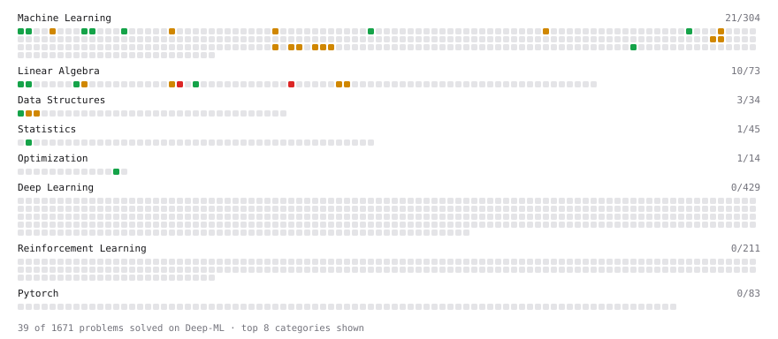

# Deep-ML

My machine learning practice from [Deep-ML](https://www.deep-ml.com). Every solution here was written by hand.

**85** solved · 57 problems · 3 labs · 25 math

[**Browse the interactive portfolio**](https://PabloVM.github.io/deep-ml/) to replay this filling in over time.

## Problems

| | Difficulty | Solved | |
| --- | --- | --- | --- |
| [Batch Iterator for Dataset](https://www.deep-ml.com/problems/30) | easy | 2026-10-22 | [solution](problems/0030-batch-iterator-for-dataset) |
| [Calculate 2x2 Matrix Inverse](https://www.deep-ml.com/problems/8) | easy | 2026-10-20 | [solution](problems/0008-calculate-2x2-matrix-inverse) |
| [Calculate Mean Absolute Error (MAE)](https://www.deep-ml.com/problems/93) | easy | 2026-10-27 | [solution](problems/0093-calculate-mean-absolute-error-mae) |
| [Calculate R-squared for Regression Analysis](https://www.deep-ml.com/problems/69) | easy | 2026-10-27 | [solution](problems/0069-calculate-r-squared-for-regression-analysis) |
| [Calculate Root Mean Square Error (RMSE)](https://www.deep-ml.com/problems/71) | easy | 2026-10-27 | [solution](problems/0071-calculate-root-mean-square-error-rmse) |
| [Derivative of a Polynomial](https://www.deep-ml.com/problems/116) | easy | 2026-10-20 | [solution](problems/0116-derivative-of-a-polynomial) |
| [Descriptive Statistics Calculator](https://www.deep-ml.com/problems/78) | easy | 2026-10-22 | [solution](problems/0078-descriptive-statistics-calculator) |
| [Detect Overfitting or Underfitting](https://www.deep-ml.com/problems/86) | easy | 2026-10-27 | [solution](problems/0086-detect-overfitting-or-underfitting) |
| [Feature Scaling Implementation](https://www.deep-ml.com/problems/16) | easy | 2026-10-27 | [solution](problems/0016-feature-scaling-implementation) |
| [Gradient Direction and Magnitude](https://www.deep-ml.com/problems/308) | easy | 2026-10-20 | [solution](problems/0308-gradient-direction-and-magnitude) |
| [Implement Orthogonal Projection of a Vector onto a Line](https://www.deep-ml.com/problems/66) | easy | 2026-10-20 | [solution](problems/0066-implement-orthogonal-projection-of-a-vector-onto-a-line) |
| [Label Encoding for Ordinal Variables](https://www.deep-ml.com/problems/356) | easy | 2026-10-27 | [solution](problems/0356-label-encoding-for-ordinal-variables) |
| [Learning Rate Range Finder for Linear Regression](https://www.deep-ml.com/problems/990) | easy | 2026-10-21 | [solution](problems/0990-learning-rate-range-finder-for-linear-regression) |
| [Linear Regression Using Gradient Descent](https://www.deep-ml.com/problems/15) | easy | 2026-10-20 | [solution](problems/0015-linear-regression-using-gradient-descent) |
| [Linear Regression Using Normal Equation](https://www.deep-ml.com/problems/14) | easy | 2026-10-20 | [solution](problems/0014-linear-regression-using-normal-equation) |
| [Matrix-Vector Dot Product](https://www.deep-ml.com/problems/1) | easy | 2026-10-20 | [solution](problems/0001-matrix-vector-dot-product) |
| [Min-Max Scaling of Feature Values](https://www.deep-ml.com/problems/112) | easy | 2026-10-25 | [solution](problems/0112-min-max-scaling-of-feature-values) |
| [One-Hot Encoding of Nominal Values](https://www.deep-ml.com/problems/34) | easy | 2026-10-25 | [solution](problems/0034-one-hot-encoding-of-nominal-values) |
| [Random Shuffle of Dataset](https://www.deep-ml.com/problems/29) | easy | 2026-10-22 | [solution](problems/0029-random-shuffle-of-dataset) |
| [Random Train/Validation/Test Split with Shuffling](https://www.deep-ml.com/problems/1058) | easy | 2026-10-22 | [solution](problems/1058-random-train-validation-test-split-with-shuffling) |
| [Shift and Scale Array to Target Range](https://www.deep-ml.com/problems/141) | easy | 2026-10-25 | [solution](problems/0141-shift-and-scale-array-to-target-range) |
| [Smooth L1 Loss with a Beta Parameter](https://www.deep-ml.com/problems/1372) | easy | 2026-10-27 | [solution](problems/1372-smooth-l1-loss-with-a-beta-parameter) |
| [Transpose of a Matrix](https://www.deep-ml.com/problems/2) | easy | 2026-10-20 | [solution](problems/0002-transpose-of-a-matrix) |
| [Vector Norms (L1/L2/L-inf) and the Frobenius Norm](https://www.deep-ml.com/problems/328) | easy | 2026-10-27 | [solution](problems/0328-vector-norms-l1-l2-l-inf-and-the-frobenius-norm) |
| [Chain Rule for Composite Functions](https://www.deep-ml.com/problems/214) | medium | 2026-10-20 | [solution](problems/0214-chain-rule-for-composite-functions) |
| [Check if Matrix is Positive Definite](https://www.deep-ml.com/problems/332) | medium | 2026-10-28 | [solution](problems/0332-check-if-matrix-is-positive-definite) |
| [Cholesky Decomposition](https://www.deep-ml.com/problems/334) | medium | 2026-10-21 | [solution](problems/0334-cholesky-decomposition) |
| [Classify Critical Points Using Hessian Eigenvalues](https://www.deep-ml.com/problems/311) | medium | 2026-10-28 | [solution](problems/0311-classify-critical-points-using-hessian-eigenvalues) |
| [ColumnTransformer-Style Dispatcher](https://www.deep-ml.com/problems/845) | medium | 2026-10-26 | [solution](problems/0845-columntransformer-style-dispatcher) |
| [Compute the Hessian Matrix](https://www.deep-ml.com/problems/218) | medium | 2026-10-28 | [solution](problems/0218-compute-the-hessian-matrix) |
| [Cross-Validated Prediction with K-Fold Linear Regression](https://www.deep-ml.com/problems/839) | medium | 2026-10-27 | [solution](problems/0839-cross-validated-prediction-with-k-fold-linear-regression) |
| [Detect Look-Ahead Bias in a Feature Pipeline](https://www.deep-ml.com/problems/1352) | medium | 2026-10-27 | [solution](problems/1352-detect-look-ahead-bias-in-a-feature-pipeline) |
| [Detect Target Leakage in a Feature Matrix](https://www.deep-ml.com/problems/1359) | medium | 2026-10-27 | [solution](problems/1359-detect-target-leakage-in-a-feature-matrix) |
| [Dummy Classifier Baseline](https://www.deep-ml.com/problems/847) | medium | 2026-10-26 | [solution](problems/0847-dummy-classifier-baseline) |
| [Dummy Regressor Baseline](https://www.deep-ml.com/problems/848) | medium | 2026-10-26 | [solution](problems/0848-dummy-regressor-baseline) |
| [Feature Hashing Trick for Sparse Features](https://www.deep-ml.com/problems/846) | medium | 2026-10-26 | [solution](problems/0846-feature-hashing-trick-for-sparse-features) |
| [Gaussian Elimination for Solving Linear Systems](https://www.deep-ml.com/problems/58) | medium | 2026-10-21 | [solution](problems/0058-gaussian-elimination-for-solving-linear-systems) |
| [Handle Missing Data with Imputation](https://www.deep-ml.com/problems/354) | medium | 2026-10-26 | [solution](problems/0354-handle-missing-data-with-imputation) |
| [Implement Gradient Descent Variants with MSE Loss](https://www.deep-ml.com/problems/47) | medium | 2026-10-20 | [solution](problems/0047-implement-gradient-descent-variants-with-mse-loss) |
| [Implement K-Fold Cross-Validation](https://www.deep-ml.com/problems/18) | medium | 2026-10-22 | [solution](problems/0018-implement-k-fold-cross-validation) |
| [Implement Stratified K-Fold Cross-Validation](https://www.deep-ml.com/problems/840) | medium | 2026-10-25 | [solution](problems/0840-implement-stratified-k-fold-cross-validation) |
| [Implement Stratified Train-Test Split](https://www.deep-ml.com/problems/275) | medium | 2026-10-23 | [solution](problems/0275-implement-stratified-train-test-split) |
| [Implement the Huber Loss Function](https://www.deep-ml.com/problems/192) | medium | 2026-10-27 | [solution](problems/0192-implement-the-huber-loss-function) |
| [Lagrange Multipliers for Constrained Quadratic Optimization](https://www.deep-ml.com/problems/314) | medium | 2026-10-28 | [solution](problems/0314-lagrange-multipliers-for-constrained-quadratic-optimization) |
| [Learning Curve Generator for Bias-Variance Diagnosis](https://www.deep-ml.com/problems/800) | medium | 2026-10-27 | [solution](problems/0800-learning-curve-generator-for-bias-variance-diagnosis) |
| [Linear Regression - Power Grid Optimization](https://www.deep-ml.com/problems/92) | medium | 2026-10-20 | [solution](problems/0092-linear-regression-power-grid-optimization) |
| [LU Decomposition of a Square Matrix](https://www.deep-ml.com/problems/333) | medium | 2026-10-21 | [solution](problems/0333-lu-decomposition-of-a-square-matrix) |
| [Matrix times Matrix ](https://www.deep-ml.com/problems/9) | medium | 2026-10-20 | [solution](problems/0009-matrix-times-matrix) |
| [Mini-Batch Gradient Descent Step for Linear Regression](https://www.deep-ml.com/problems/803) | medium | 2026-10-20 | [solution](problems/0803-mini-batch-gradient-descent-step-for-linear-regression) |
| [Numerical Gradient Checking](https://www.deep-ml.com/problems/313) | medium | 2026-10-21 | [solution](problems/0313-numerical-gradient-checking) |
| [Ordinal Encoding for Categorical Features](https://www.deep-ml.com/problems/843) | medium | 2026-10-26 | [solution](problems/0843-ordinal-encoding-for-categorical-features) |
| [Outlier Detection and Removal Using IQR Method](https://www.deep-ml.com/problems/355) | medium | 2026-10-26 | [solution](problems/0355-outlier-detection-and-removal-using-iqr-method) |
| [Partial Derivatives of Multivariable Functions](https://www.deep-ml.com/problems/215) | medium | 2026-10-20 | [solution](problems/0215-partial-derivatives-of-multivariable-functions) |
| [StandardScaler Fit and Transform](https://www.deep-ml.com/problems/842) | medium | 2026-10-25 | [solution](problems/0842-standardscaler-fit-and-transform) |
| [Stochastic Gradient Descent Step for Linear Regression](https://www.deep-ml.com/problems/802) | medium | 2026-10-20 | [solution](problems/0802-stochastic-gradient-descent-step-for-linear-regression) |
| [Implement the Conjugate Gradient Method for Solving Linear Systems](https://www.deep-ml.com/problems/63) | hard | 2026-10-21 | [solution](problems/0063-implement-the-conjugate-gradient-method-for-solving-linear-systems) |
| [QR Decomposition](https://www.deep-ml.com/problems/201) | hard | 2026-10-21 | [solution](problems/0201-qr-decomposition) |

## Labs

| | Difficulty | Solved | |
| --- | --- | --- | --- |
| [Split the Data Honestly and Beat a Baseline](https://www.deep-ml.com/labs/3d26c3f9-cb73-4ab1-bc4d-86cfab2af6d1) | easy | 2026-10-27 | [solution](labs/3d26c3f9-cb73-4ab1-bc4d-86cfab2af6d1-split-the-data-honestly-and-beat-a-baseline) |
| [Train a Linear Regression Model](https://www.deep-ml.com/labs/18) | easy | 2026-10-23 | [solution](labs/0018-train-a-linear-regression-model) |
| [Data Preprocessing: Handling Missing Values](https://www.deep-ml.com/labs/11) | medium | 2026-10-27 | [solution](labs/0011-data-preprocessing-handling-missing-values) |

## Math

| | Difficulty | Solved | |
| --- | --- | --- | --- |
| [Derivatives and Gradients](https://www.deep-ml.com/math-problems/1) | easy | 2026-10-20 | [solution](math/0001-derivatives-and-gradients) |
| [Descriptive Statistics](https://www.deep-ml.com/math-problems/18) | easy | 2026-10-22 | [solution](math/0018-descriptive-statistics) |
| [Gradient Descent Updates](https://www.deep-ml.com/math-problems/5) | easy | 2026-10-20 | [solution](math/0005-gradient-descent-updates) |
| [ML Workflow Basics](https://www.deep-ml.com/math-problems/30) | easy | 2026-10-22 | [solution](math/0030-ml-workflow-basics) |
| [Model Selection: CV, AIC, and BIC](https://www.deep-ml.com/math-problems/43) | easy | 2026-10-28 | [solution](math/0043-model-selection-cv-aic-and-bic) |
| [Why Minibatches: Gradient Variance vs Batch Size](https://www.deep-ml.com/math-problems/130) | easy | 2026-10-20 | [solution](math/0130-why-minibatches-gradient-variance-vs-batch-size) |
| [$C_p$, AIC, BIC, and Adjusted $R^2$](https://www.deep-ml.com/math-problems/93) | medium | 2026-10-28 | [solution](math/0093-c-p-aic-bic-and-adjusted-r-2) |
| [Best Subset and Stepwise Selection](https://www.deep-ml.com/math-problems/107) | medium | 2026-10-28 | [solution](math/0107-best-subset-and-stepwise-selection) |
| [Bias–Variance Decomposition](https://www.deep-ml.com/math-problems/39) | medium | 2026-10-28 | [solution](math/0039-bias-variance-decomposition) |
| [Inverse and Rank](https://www.deep-ml.com/math-problems/12) | medium | 2026-10-20 | [solution](math/0012-inverse-and-rank) |
| [Least Squares and the Normal Equations](https://www.deep-ml.com/math-problems/34) | medium | 2026-10-20 | [solution](math/0034-least-squares-and-the-normal-equations) |
| [LOOCV vs $k$-Fold: the Bias-Variance of $k$](https://www.deep-ml.com/math-problems/80) | medium | 2026-10-28 | [solution](math/0080-loocv-vs-k-fold-the-bias-variance-of-k) |
| [Multivariate Calculus](https://www.deep-ml.com/math-problems/2) | medium | 2026-10-20 | [solution](math/0002-multivariate-calculus) |
| [Optimization: Convexity and Critical Points](https://www.deep-ml.com/math-problems/6) | medium | 2026-10-27 | [solution](math/0006-optimization-convexity-and-critical-points) |
| [Orthogonality and Projections](https://www.deep-ml.com/math-problems/14) | medium | 2026-10-20 | [solution](math/0014-orthogonality-and-projections) |
| [Positive Definite Matrices and Quadratic Forms](https://www.deep-ml.com/math-problems/50) | medium | 2026-10-28 | [solution](math/0050-positive-definite-matrices-and-quadratic-forms) |
| [Regularization and Generalization](https://www.deep-ml.com/math-problems/31) | medium | 2026-10-28 | [solution](math/0031-regularization-and-generalization) |
| [Solving Linear Systems](https://www.deep-ml.com/math-problems/13) | medium | 2026-10-21 | [solution](math/0013-solving-linear-systems) |
| [Training Error, Test Error and the Bayes Rate](https://www.deep-ml.com/math-problems/104) | medium | 2026-10-22 | [solution](math/0104-training-error-test-error-and-the-bayes-rate) |
| [Vector Norms and Linear Independence](https://www.deep-ml.com/math-problems/8) | medium | 2026-10-27 | [solution](math/0008-vector-norms-and-linear-independence) |
| [What Goes Wrong in High Dimensions](https://www.deep-ml.com/math-problems/109) | medium | 2026-10-28 | [solution](math/0109-what-goes-wrong-in-high-dimensions) |
| [Interpolation and Double Descent](https://www.deep-ml.com/math-problems/118) | hard | 2026-10-28 | [solution](math/0118-interpolation-and-double-descent) |
| [Matrix Decompositions: LU and QR](https://www.deep-ml.com/math-problems/15) | hard | 2026-10-21 | [solution](math/0015-matrix-decompositions-lu-and-qr) |
| [Maximum Likelihood and MAP](https://www.deep-ml.com/math-problems/26) | hard | 2026-10-28 | [solution](math/0026-maximum-likelihood-and-map) |
| [Ridge vs Lasso: Constraint Geometry and Soft-Thresholding](https://www.deep-ml.com/math-problems/94) | hard | 2026-10-28 | [solution](math/0094-ridge-vs-lasso-constraint-geometry-and-soft-thresholding) |

---

_This file is regenerated by Deep-ML on every push._
